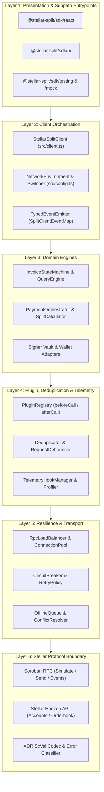
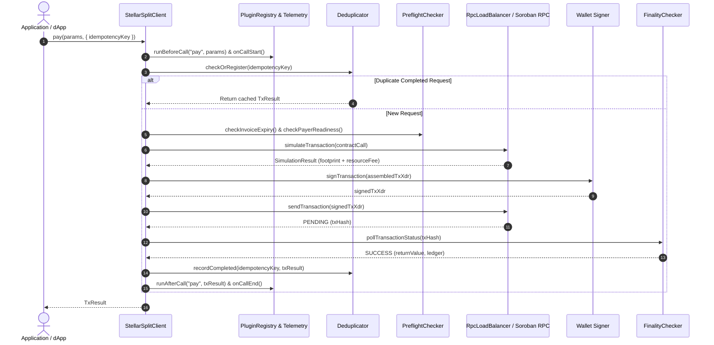
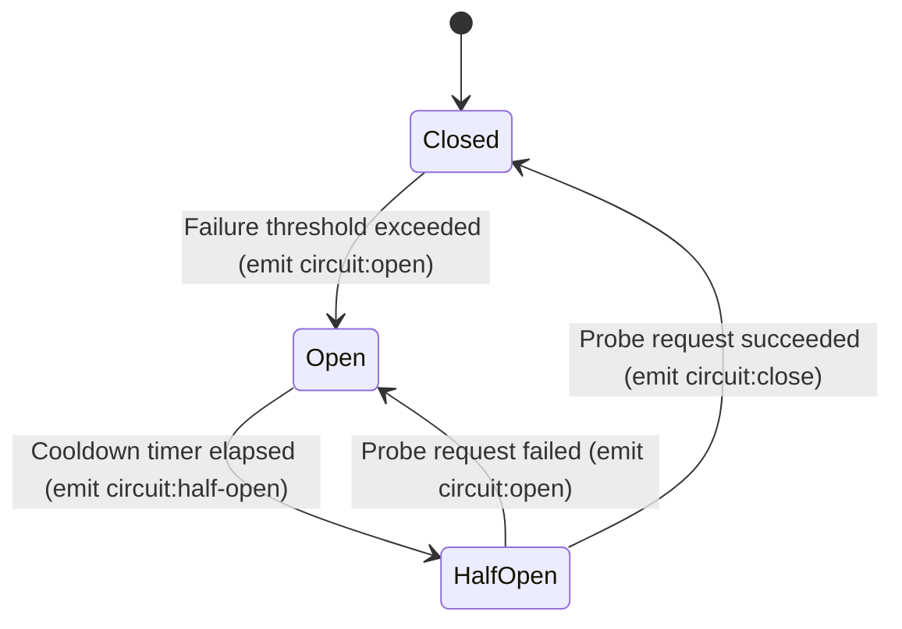

# Architecture

This document maps the architecture, design decisions (ADRs), interaction diagrams, public API surface, extension points, and specification references for **`@stellar-split/sdk`**.

---

## Table of Contents

1. [Architectural Overview & 6-Layer Map](#1-architectural-overview--6-layer-map)
2. [System & Sequence Diagrams](#2-system--sequence-diagrams)
3. [Design Decisions (Architecture Decision Records)](#3-design-decisions-architecture-decision-records)
4. [Request Deduplication for Idempotency](#4-request-deduplication-for-idempotency)
5. [Public API Surface & Subpath Entrypoints](#5-public-api-surface--subpath-entrypoints)
6. [Extension Points & Customization Guide](#6-extension-points--customization-guide)
7. [References & Specifications](#7-references--specifications)

---

## 1. Architectural Overview & 6-Layer Map

`@stellar-split/sdk` is structured as a strict 6-layer modular architecture with downward-only dependencies. Higher layers depend on lower abstractions, ensuring that core Soroban invoice splitting logic can run in Node.js backends, serverless edge workers, CLI tools, or browser dApps without pulling in UI or framework dependencies.

| Layer | Name | Key Modules | Core Responsibility |
| :--- | :--- | :--- | :--- |
| **Layer 1** | **Presentation, UI & Framework Bindings** | `src/react/`, `src/ui/`, `src/qr/`, `src/lazy/` | Optional React 18/19 hooks (`useSplitClient`, `useInvoice`), headless UI view-models (`splitPreview.ts`), QR payloads, and lazy code-splitting loaders. |
| **Layer 2** | **Client Orchestration & Event Bus** | `src/client.ts`, `src/config.ts`, `src/events/TypedEventEmitter.ts` | Primary `StellarSplitClient` facade, runtime network switching (`MAINNET`, `TESTNET`, `FUTURENET`, `CUSTOM`), and strongly typed `SplitClientEventMap` emission. |
| **Layer 3** | **Domain Engines** | `src/state/InvoiceStateMachine.ts`, `src/paymentOrchestrator.ts`, `src/paymentAllocation.ts`, `src/signing/signer.ts`, `src/escrowVaultManager.ts`, `src/sep41Adapter.ts` | Deterministic invoice state machine, `bigint` split allocation, multi-asset path routing, escrow/dispute workflows, and unified multi-wallet signing. |
| **Layer 4** | **Plugin, Interceptor, Deduplication & Telemetry** | `src/plugin.ts`, `src/interceptors.ts`, `src/dedup.ts`, `src/telemetryHooks.ts`, `src/profiler.ts` | Onion middleware (`PluginRegistry`), HTTP/RPC request/response interceptors, `Idempotency-Key` request deduplication, and fire-and-forget telemetry hooks. |
| **Layer 5** | **Resilience, Caching & RPC Transport** | `src/rpc/RpcLoadBalancer.ts`, `src/resilience/CircuitBreaker.ts`, `src/retryPolicy.ts`, `src/offlineQueue.ts`, `src/connectionPool.ts`, `src/cache.ts` | Multi-endpoint RPC load balancing with health quarantine, closed/open/half-open circuit breaking, jittered retries, connection pooling, and offline queueing. |
| **Layer 6** | **Stellar Protocol Boundary** | `src/xdrDecoder.ts`, `src/errors.ts`, `src/horizonErrorClassifier.ts`, `src/sorobanFeatureDetector.ts` | `@stellar/stellar-sdk` wrapping, Soroban `ScVal` XDR serialization, ledger footprint sizing, and mapping contract/Horizon errors to 60+ typed `StellarSplitError` classes. |

---

## 2. System & Sequence Diagrams

### 2.1 Layered System Architecture



### 2.2 Mutating Transaction Lifecycle (`Preflight -> Simulate -> Sign -> Submit -> Confirm`)



### 2.3 Resilience & Circuit Breaker State Machine



---

## 3. Design Decisions (Architecture Decision Records)

### ADR-001: Strict `bigint` Representation for Stroop & Token Amounts
- **Context**: IEEE-754 floating-point numbers lose integer precision above `2^53 - 1` and cause 1-stroop rounding discrepancies across multi-recipient invoice splits.
- **Decision**: All token quantities, stroop balances, and fee ceilings use native `bigint` values across public inputs and outputs, paired with `parseAmount()` and `formatAmount()` at display boundaries.
- **Consequences**: Zero rounding drift across proportional and waterfall allocations; direct compatibility with Soroban `i128` / `u64` XDR `ScVal` types.

### ADR-002: Simulate-Before-Submit Pipeline with Local Preflight Guards
- **Context**: Submitting invalid Soroban transactions wastes base fees and prompts users to sign transactions that will trap on-chain.
- **Decision**: Every mutating operation executes local preflight checks (`checkInvoiceExpiry`, `checkPayerReadiness`) followed by Soroban `simulateTransaction` to compute the exact ledger footprint and resource fee before invoking the wallet signer.
- **Consequences**: Domain errors (`DeadlinePassedError`, `InsufficientBalanceError`, `NftGateRequiredError`) surface before any wallet popup appears.

### ADR-003: Onion Middleware (`PluginRegistry`) + Fire-and-Forget `TelemetryHooks`
- **Context**: Production applications need custom audit logging, caching, and OpenTelemetry/Sentry instrumentation without bloating the core SDK bundle.
- **Decision**: Separate functional interception (`PluginRegistry` running `beforeCall` in registration order and `afterCall`/`onError` in reverse order) from observability (`TelemetryHookManager` executing non-blocking, exception-isolated hooks).
- **Consequences**: Observability failures never interrupt payment execution; zero hard dependency on external APM agents.

### ADR-004: Multi-Endpoint RPC Load Balancing & Circuit Breaking
- **Context**: Individual Soroban RPC or Horizon nodes can experience rate limits, ledger lag, or transient downtime.
- **Decision**: Route RPC traffic through `RpcLoadBalancer` (which demotes unhealthy endpoints and reinstates them on recovery) protected by `CircuitBreaker` and per-method `retryPolicy`.
- **Consequences**: Automatic failover across backup RPC providers and fast-fail protection during network-wide degradation.

### ADR-005: Subpath Exports for Tree-Shakeable Bundles
- **Context**: Backend services and CLI scripts should not bundle React hooks or UI helpers.
- **Decision**: Expose 8 subpath exports (`.`, `./ui`, `./react`, `./testing`, `./mock`, `./telemetry`, `./utils`, `./lazy`) with `sideEffects: false` and automated bundle size guards (`scripts/bundle-size-guard.ts`).
- **Consequences**: Minimal bundle footprint across browser, Node.js, and edge runtimes.

---

## 4. Request Deduplication for Idempotency

Idempotent operations are protected by a request deduplication layer that
prevents the same logical request from being executed more than once.

### Design

- **Idempotency key**: every idempotent request carries a client-supplied
  `Idempotency-Key` header (or an equivalent key derived from the request
  payload). The key uniquely identifies the logical operation.
- **Request tracking**: a deduplication store records each key together with
  its state (`in-flight` or `completed`), the owning request, and timestamps.
- **Duplicate detection**: when a request arrives with a key that is already
  tracked, the layer does not re-execute the operation. If the original is
  still `in-flight`, the duplicate waits for (or is rejected with a conflict
  response for) the original result. If it is `completed`, the cached
  response is returned immediately.
- **Response caching**: the outcome (status, headers, body) of a completed
  idempotent request is cached against its key so that retries receive the
  identical response.
- **Cleanup**: tracked entries and cached responses expire after a
  configurable TTL and are purged by a periodic cleanup task, bounding memory
  usage and allowing keys to be reused after the retention window.
- **Metrics**: the layer exposes counters for deduplicated requests, cache
  hits, in-flight collisions, and expired entries so operators can observe
  deduplication behavior.

### Guarantees

- Repeated requests with the same idempotency key produce the same response
  and never execute the underlying operation twice.
- Concurrent duplicates are serialized against the original request.
- Stale entries are removed automatically by the cleanup process.

---

## 5. Public API Surface & Subpath Entrypoints

| Subpath Import | Source Entrypoint | Primary Exports | Target Consumers |
| :--- | :--- | :--- | :--- |
| `@stellar-split/sdk` | `src/index.ts` | `StellarSplitClient`, `NetworkEnvironment`, `NETWORK_PRESETS`, `PluginRegistry`, `StellarSplitError`, `HealthCheckRegistry`, `RpcConnectionPool` | All Node.js & browser consumers |
| `@stellar-split/sdk/ui` | `src/ui/index.ts` | `buildSplitPreview`, `PaymentProgressTracker`, receipt formatters | Frontend UI layers |
| `@stellar-split/sdk/react` | `src/react/index.ts` | `StellarSplitProvider`, `useSplitClient`, `useInvoice` | React 18 / 19 dApps |
| `@stellar-split/sdk/testing` | `src/testing/index.ts` | `SimulationSandbox`, test wallet harnesses, invoice fixture factories | Integration & unit test suites |
| `@stellar-split/sdk/mock` | `src/mock/index.ts` | `MockStellarSplitClient`, deterministic mock responses | Storybook & offline UI tests |
| `@stellar-split/sdk/telemetry` | `src/telemetryModule.ts` | `TelemetryHookManager`, OpenTelemetry span & metric bridges | Production APM & observability |
| `@stellar-split/sdk/utils` | `src/utils.ts` | `parseAmount`, `formatAmount`, `isValidStellarAddress`, `truncateAddress`, `isExpired` | Lightweight validation & formatting |
| `@stellar-split/sdk/lazy` | `src/lazy/index.ts` | `LazyInitializer`, deferred analytics/PDF loaders | Bundle-size-sensitive web apps |

---

## 6. Extension Points & Customization Guide

### 6.1 Custom Lifecycle Plugins (`SdkPlugin`)
Implement `SdkPlugin` (`src/plugin.ts`) and register via `client.use(plugin)` to intercept `createInvoice` and `pay`:

```typescript
import { SdkPlugin } from "@stellar-split/sdk";

export const AuditPlugin: SdkPlugin = {
  name: "custom-audit-plugin",
  install(client) {
    client.on("payment", (evt) => console.info("Payment event:", evt));
  },
  beforeCall(method, args) {
    return args;
  },
  afterCall(method, result) {
    return result;
  },
  onError(method, err) {
    console.error(`Method ${method} failed:`, err);
  },
};
```

### 6.2 Custom Telemetry Hooks (`TelemetryHooks`)
Pass `telemetryHooks` in `StellarSplitClientConfig` (`src/telemetryHooks.ts`) to stream traces and metrics into Sentry, Datadog, or OpenTelemetry:

```typescript
import { TelemetryHooks } from "@stellar-split/sdk";

export const telemetryHooks: TelemetryHooks = {
  onCallStart: ({ method, traceId }) => {},
  onCallEnd: ({ method, durationMs, success }) => {},
  onError: (error, context) => {},
  onProfile: ({ measurement, stats }) => {},
};
```

### 6.3 Custom Wallet & HSM Signers (`Signer`)
Implement the `Signer` interface (`src/signing/signer.ts`) to sign transactions using AWS KMS, HashiCorp Vault, Fireblocks, or a custom hardware wallet:

```typescript
import type { Signer } from "@stellar-split/sdk";

export class VaultHsmSigner implements Signer {
  constructor(private readonly accountAddress: string) {}
  async getPublicKey(): Promise<string> {
    return this.accountAddress;
  }
  async signTransaction(txXdr: string): Promise<string> {
    // Sign XDR payload with remote HSM and return signed XDR
    return txXdr;
  }
}
```

### 6.4 Request & Response Interceptors (`src/interceptors.ts`)
Use `addRequestInterceptor` and `addResponseInterceptor` to attach custom authentication headers, HMAC request signatures (`src/requestSigner.ts`), or payload compression (`src/compression.ts`).

### 6.5 Custom Health Checks (`src/healthCheck.ts`)
Register infrastructure checks with `HealthCheckRegistry` using `createServiceHealthCheck`, `createDependencyHealthCheck`, or `createCustomHealthCheck` and expose them via `HealthEndpoints` (`/liveness`, `/readiness`, `/health`).

### 6.6 Contract Upgrade State Migrations (`src/upgradeMigrationRunner.ts`)
Register state migration callbacks via `registerUpgradeMigration(fromHash, toHash, migrateFn)` paired with `watchContractUpgrade()` (`src/upgrade.ts`) to seamlessly transform cached entries when the on-chain Soroban contract WASM is upgraded.

---

## 7. References & Specifications

### Internal Documentation
- **[API Reference (`docs/API.md`)](docs/API.md)** — Full client method reference and type definitions.
- **[Architecture Deep-Dive Guide (`docs/ARCHITECTURE_GUIDE.md`)](docs/ARCHITECTURE_GUIDE.md)** — Subsystem contracts, data flow invariants, and contributor guidelines.
- **[Error Codes (`docs/ERROR_CODES.md`)](docs/ERROR_CODES.md)** — Complete catalog of `StellarSplitError` subclasses and Soroban contract error codes.
- **[Telemetry Hooks (`docs/TELEMETRY_HOOKS.md`)](docs/TELEMETRY_HOOKS.md)** — Observability hook contracts and profiler integration.
- **[Signing Vault (`docs/SIGNING_VAULT.md`)](docs/SIGNING_VAULT.md)** — Multi-wallet and threshold signature architecture.
- **[Performance Tuning (`docs/PERFORMANCE_TUNING.md`)](docs/PERFORMANCE_TUNING.md)** — Footprint optimization, batching, and connection pooling.
- **[Webhook Middleware (`docs/WEBHOOK_MIDDLEWARE.md`)](docs/WEBHOOK_MIDDLEWARE.md)** — HMAC signature verification, replay protection, and event delivery.
- **[Migration Guides (`docs/MIGRATION.md`)](docs/MIGRATION.md)** — Version upgrade paths and breaking change remediation.

### Stellar & Soroban Specifications
- **[Stellar Soroban RPC Specification](https://developers.stellar.org/docs/data/rpc)** — `simulateTransaction`, `sendTransaction`, `getTransaction`, `getEvents`, and `getLedgerEntries`.
- **[Stellar Horizon API Reference](https://developers.stellar.org/network/horizon)** — Account state, trustlines, orderbooks, and path payment discovery.
- **[SEP-0041: Soroban Token Interface](https://github.com/stellar/stellar-protocol/blob/master/ecosystem/sep-0041.md)** — Standard token contract interface implemented by `src/sep41Adapter.ts`.
- **[SEP-0010: Stellar Web Authentication](https://github.com/stellar/stellar-protocol/blob/master/ecosystem/sep-0010.md)** — Challenge-response authentication for institutional endpoints.
- **[SEP-0024 & SEP-0031: Hosted Deposit/Withdrawal & Cross-Border Payments](https://github.com/stellar/stellar-protocol)** — Anchor interoperability protocols supported in `src/sep/`.
