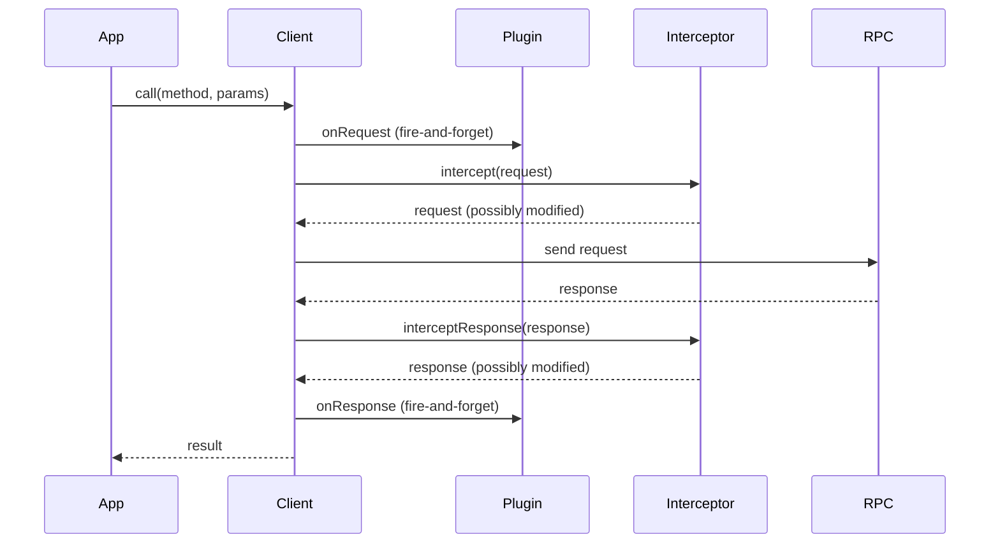
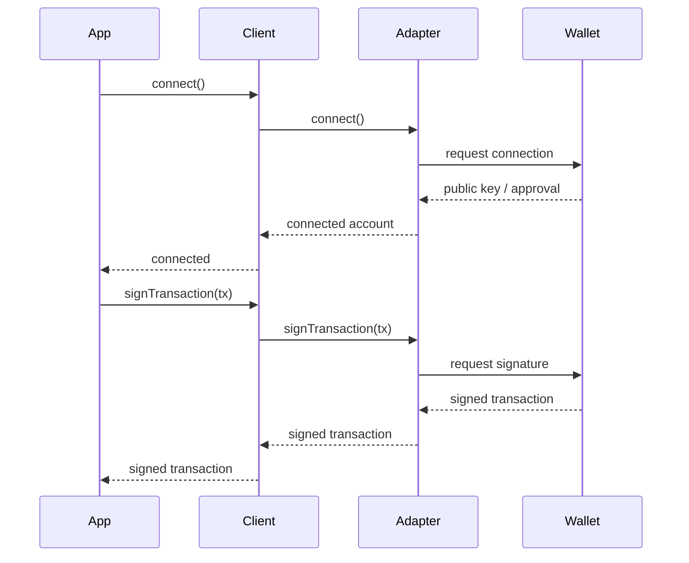
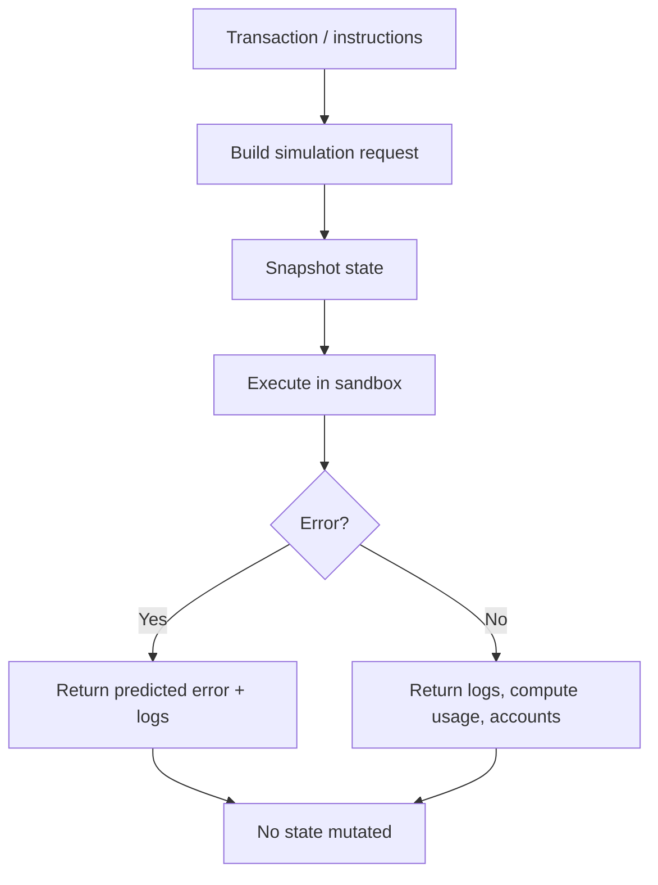

# Architecture

This document describes the architecture of the SDK, the reasoning behind its
key design decisions, and the extension points it exposes. It is intended for
contributors and for integrators who need to understand how the pieces fit
together before building on top of the SDK.

## Contents

- [Architecture Map](#architecture-map)
- [Design Decision Log](#design-decision-log)
- [Diagrams](#diagrams)
- [API Surface](#api-surface)
- [Extension Points](#extension-points)
- [Request Deduplication for Idempotency](#request-deduplication-for-idempotency)
- [References](#references)

## Architecture Map

The SDK is organized into a small number of layers with a strict dependency
direction: higher layers may depend on lower layers, never the reverse.

| Layer | Responsibility | Key modules |
| --- | --- | --- |
| **Client** | Public entry point. Builds requests, applies configuration, orchestrates the request lifecycle, and exposes the typed API surface. | `src/index.ts`, client core |
| **Wallet adapters** | Uniform interface over heterogeneous wallet implementations (browser extensions, hardware, in-memory). Normalizes connect/sign flows and error shapes. | wallet adapter modules |
| **Simulation** | Side-effect-free evaluation of transactions and instructions. Produces predicted outcomes (logs, compute usage, errors) without submitting anything. | simulation modules |
| **Plugins / interceptors / telemetry** | Cross-cutting concerns. Plugins observe lifecycle events, RPC interceptors wrap transport calls, telemetry hooks emit metrics and traces. | `src/plugin.ts`, `src/interceptors.ts`, `src/telemetryHooks.ts` |
| **CLI / docs tooling** | Developer-facing tooling: scaffolding, code generation, and documentation checks. Not part of the runtime dependency graph. | CLI and docs tooling |

Dependency direction:

```
CLI / docs tooling  ──▶  Client  ──▶  Wallet adapters
                          │  │
                          │  └────▶  Simulation
                          │
                          └───────▶  Plugins / interceptors / telemetry
```

The client is the only layer that composes the others. Wallet adapters and
simulation do not know about each other; plugins, interceptors, and telemetry
hooks are attached to the client and never imported by lower layers.

## Design Decision Log

### Why a single wallet adapter interface?

Wallet implementations differ wildly in their APIs, event models, and error
semantics. Rather than leaking those differences into the client, the SDK
defines one adapter interface (`connect`, `disconnect`, `signTransaction`,
`signMessage`, plus capability flags). The client only ever talks to this
interface.

Consequences:

- New wallets are supported by writing an adapter, not by changing the client.
- Error handling and capability checks are implemented once, in the client.
- Adapters can be tested in isolation with in-memory fakes.

### Why is simulation side-effect free?

Simulation is used to predict outcomes before committing to them. If
simulation could mutate state (submit transactions, consume nonces, or write
to caches), it could not be safely run speculatively, in parallel, or in
tests. Keeping simulation side-effect free means:

- It can be run on every request without changing observable behavior.
- Results are deterministic for a given input and state snapshot.
- It is safe to run in CI and in dry-run modes.

### Why are plugin hooks fire-and-forget?

Plugin hooks are invoked synchronously at lifecycle points, but their return
values are ignored and their errors are isolated. This is deliberate:

- A misbehaving plugin must never break or slow down the request path.
- Plugins are for observation (logging, metrics, tracing), not for
  transforming requests or responses. Transformation belongs in RPC
  interceptors, which have an explicit contract.
- Fire-and-forget hooks keep the request lifecycle simple and predictable.

If a plugin needs to influence a request, it should be implemented as an RPC
interceptor instead.

## Diagrams

### Request lifecycle



### Wallet adapter flow



### Simulation flow



## API Surface

The public API is defined by the exports of `src/index.ts`. Everything not
exported from that entry point is internal and may change without notice.

The entry point re-exports, at minimum:

- **Client**: the main client class/factory and its configuration type.
- **Wallet adapters**: the adapter interface, capability types, and the
  built-in adapters.
- **Simulation**: simulation request/result types and the simulation entry
  function.
- **Plugins**: the plugin interface and registration helpers from
  `src/plugin.ts`.
- **Interceptors**: the RPC interceptor interface and helpers from
  `src/interceptors.ts`.
- **Telemetry**: telemetry hook types and registration from
  `src/telemetryHooks.ts`.
- **Errors**: the SDK error hierarchy and error codes.

For the full, generated list of exported symbols and their signatures, see
[docs/API.md](docs/API.md).

## Extension Points

### Plugins (`src/plugin.ts`)

Plugins observe the request lifecycle. A plugin implements optional hooks such
as `onRequest`, `onResponse`, and `onError`. Hooks are fire-and-forget: return
values are ignored and thrown errors are caught and reported to telemetry so
they cannot affect the request. Register plugins through the client
configuration.

### RPC interceptors (`src/interceptors.ts`)

Interceptors wrap transport calls and may modify requests and responses. They
are composed in registration order for requests and in reverse order for
responses, mirroring a middleware chain. Unlike plugins, interceptors have an
explicit contract: they receive a value and must return a value (or throw to
abort). Use interceptors for retries, header injection, and response
transformation.

### Telemetry hooks (`src/telemetryHooks.ts`)

Telemetry hooks receive structured events (request start/end, errors, plugin
failures, simulation results) and are intended for metrics and tracing
backends. Like plugin hooks they are fire-and-forget and must not throw; any
error raised by a hook is swallowed and counted. See
[docs/TELEMETRY_HOOKS.md](docs/TELEMETRY_HOOKS.md) for the event schema.

## Request Deduplication for Idempotency
=======

Idempotent operations are protected by a request deduplication layer that
prevents the same logical request from being executed more than once.

### Design

- **Idempotency key**: every idempotent request carries a client-supplied
  `Idempotency-Key` header (or an equivalent key derived from the request
  payload). The key uniquely identifies the logical operation.
- **Request tracking**: a deduplication store records each key together with
  its state (`in-flight` or `completed`), the owning request, and timestamps.
- **Duplicate detection**: when a request arrives with a key that is already
  tracked, the layer does not re-execute the operation. If the original is
  still `in-flight`, the duplicate waits for (or is rejected with a conflict
  response for) the original result. If it is `completed`, the cached
  response is returned immediately.
- **Response caching**: the outcome (status, headers, body) of a completed
  idempotent request is cached against its key so that retries receive the
  identical response.
- **Cleanup**: tracked entries and cached responses expire after a
  configurable TTL and are purged by a periodic cleanup task, bounding memory
  usage and allowing keys to be reused after the retention window.
- **Metrics**: the layer exposes counters for deduplicated requests, cache
  hits, in-flight collisions, and expired entries so operators can observe
  deduplication behavior.

### Guarantees

- Repeated requests with the same idempotency key produce the same response
  and never execute the underlying operation twice.
- Concurrent duplicates are serialized against the original request.
- Stale entries are removed automatically by the cleanup process.

## References

- [README.md](README.md) — project overview and quick start.
- [docs/API.md](docs/API.md) — generated API reference for the public surface.
- [docs/MIGRATION.md](docs/MIGRATION.md) — migration guide between major
  versions, including breaking changes to adapters, interceptors, and hooks.
- [docs/TELEMETRY_HOOKS.md](docs/TELEMETRY_HOOKS.md) — telemetry hook event
  schema and usage.
